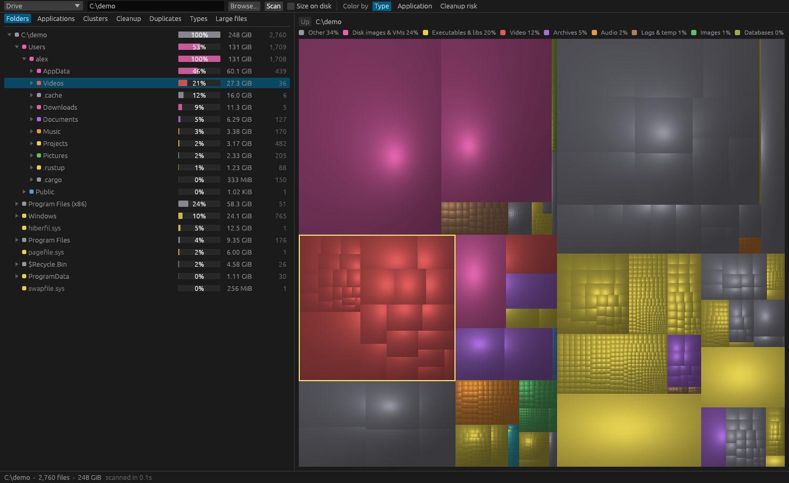
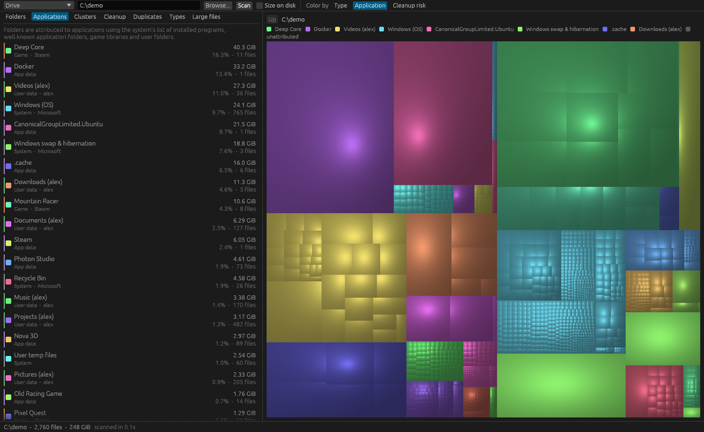
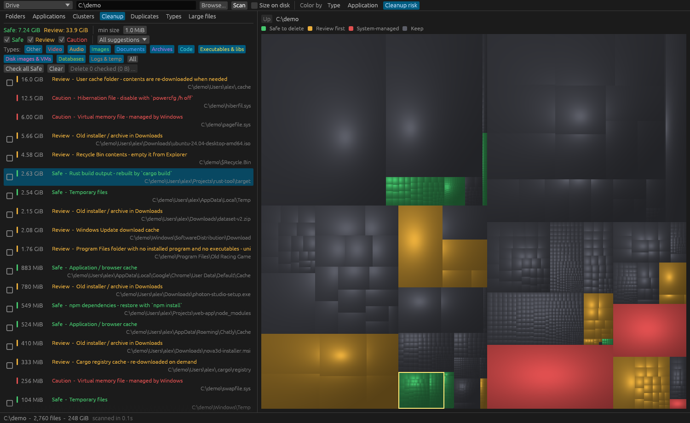

# DiskScope

**A fast, free disk space analyzer for Windows and macOS, written in Rust.**

Scan a drive or folder and see where the space went: a cushion-shaded treemap in the spirit of WinDirStat, plus which applications own it, where the large clusters are, and what is safe to delete.

- **Fast.** Parallel, async scanning; multi-million-file drives in seconds, with the UI staying responsive throughout.
- **Understands your system.** Attributes space to installed applications and games, not just folders.
- **Cleans up carefully.** Graded suggestions (Safe / Review / Caution), Recycle Bin or Trash by default, and nothing is removed without a confirmation.
- **Small and local.** A single executable. No installer, no telemetry, no network access.



## Contents

- [Screenshots](#screenshots) · [Install](#install) · [Usage](#usage) · [Deleting files](#deleting-files) · [macOS notes](#macos-notes)
- [Build from source](#build-from-source) · [Contributing](#contributing) · [Architecture](#architecture)
- [Performance](#performance) · [Known limitations](#known-limitations) · [License](#license)

## Features

| | |
| --- | --- |
| **Treemap** | Squarified layout with cushion shading. Hover for details, click to select, double-click to zoom. Color by file type, application, or cleanup risk. |
| **Applications** | Folders attributed to installed programs and well-known app locations (Windows: registry, Program Files, ProgramData, AppData; macOS: `/Applications`, `~/Library`, Homebrew), plus Steam and Epic game libraries. |
| **Large clusters** | The non-overlapping folders (or loose-file groups) where space actually concentrates, with an adjustable threshold. |
| **Cleanup suggestions** | Build output (`target`, `node_modules`, `bin`/`obj`), caches, temp files, crash dumps, old installers, large untouched files, and OS-specific rules (Windows: Temp, Windows Update cache, `Windows.old`, Recycle Bin; macOS: `~/Library/Caches` and `Logs`, Xcode DerivedData and device support, iOS simulators, iPhone backups, Trash, Docker image). Filter by risk, size and file type. |
| **Uninstall leftovers** | Windows: Program Files folders with no program in them, and data of Store apps that are no longer installed. |
| **Duplicates** | Size, then a 64 KiB prefix hash, then a full BLAKE3 hash, all in parallel. |
| **And more** | File-type breakdown, largest files, folder tree, breadcrumb navigation, and a context menu (show in file manager, copy path, delete). |

## Screenshots

| Which app owns the space | What is safe to delete |
| --- | --- |
|  |  |

*All screenshots show a made-up demo disk (invented applications and paths), not a real machine.*

## Install

Download the latest build from the [Releases](../../releases) page.

| Platform | File | Notes |
| --- | --- | --- |
| Windows 10/11 (x64) | `diskscope-<version>-windows-x86_64.exe` (or the `.zip`) | One self-contained executable. No installer, no admin rights needed. |
| macOS 11+ | `diskscope-<version>-macos-universal.zip` | A universal `DiskScope.app`. See [macOS notes](#macos-notes). |

Each release includes `SHA256SUMS.txt` so you can verify your download.

> **Intel Macs:** the universal app contains an Intel (x86_64) build, and CI checks that it compiles, but it has **not been tested on real Intel hardware**. It has been run on Apple Silicon. If you try it on an Intel Mac, please [open an issue](../../issues) with how it went.

## Usage

1. Pick a drive from the drop-down, type a path, or press **Browse…**, then press **Scan**.
2. Explore with the tabs on the left (Folders, Applications, Clusters, Cleanup, Duplicates, Types, Large files). The treemap on the right follows your selection.
3. Switch **Color by** between file type, application and cleanup risk to see the same data three ways.
4. In **Cleanup**, tick what you want to remove and press **Delete…**. See [Deleting files](#deleting-files).

**Size on disk** (on by default) reports allocated space, which is what deleting actually frees. Turn it off for logical file sizes.

### Command line

A headless report, handy for scripting and benchmarking:

```bash
diskscope --cli C:\             # Windows: types, applications, clusters, cleanup suggestions
diskscope --cli ~               # macOS: scan the home folder
diskscope --cli C:\ --logical   # logical file length instead of size on disk
```

`DISKSCOPE_IO_THREADS` overrides the size of the I/O thread pool.

## Deleting files

Nothing is deleted without a confirmation dialog.

- Deletion goes to the **Recycle Bin** (Windows) or **Trash** (macOS) by default. Windows may delete items that are too large for the bin permanently.
- An opt-in checkbox deletes **permanently**, with a warning. Permanent deletion cannot be undone.
- The scan root and **Caution** (system-managed) items are refused, and items nested inside another selected item are dropped from the plan.
- Items are removed one at a time, the views update as they go, a progress bar with a Stop button shows in the status bar, and a failure on one item does not stop the rest.

## macOS notes

**First launch.** The app is ad-hoc signed but **not notarized** (that needs a paid Apple Developer account), so Gatekeeper blocks it the first time: right-click `DiskScope.app` → **Open** → **Open**, or run `xattr -dr com.apple.quarantine DiskScope.app` once.

**Full Disk Access.** To scan protected folders (Mail, Messages, Photos, other users' data), grant the app Full Disk Access in *System Settings → Privacy & Security*. Without it those folders show as unreadable and everything else still works.

**Scanning `/`.** Other mounted volumes and the firmlinked Data volume are skipped so files are not counted twice.

### Xcode simulators

**Cleanup → Manage simulator runtimes** lists Xcode's installed runtime images and their sizes, even when scanning only your home folder. Select **Remove…**, then confirm permanent removal. DiskScope runs `xcrun simctl runtime delete <UUID>` in the background and shows any failure from Apple's tool. This skips the Trash and may shut down simulators using the runtime. Refresh the list or rescan afterwards. System-wide CoreSimulator caches are Caution entries rather than ordinary deletion suggestions.

Individual simulator device folders under `~/Library/Developer/CoreSimulator/Devices` are listed separately, also as **Caution**, rather than suggesting deletion of all CoreSimulator data. Use `xcrun simctl list devices` to identify a device, then `xcrun simctl delete <UUID>` to remove it and its data. Remove runtime versions through **Xcode → Settings → Components**. Simulator caches are listed on their own. Rescan after removing a device or runtime to update sizes.

## Build from source

You need a recent stable [Rust toolchain](https://rustup.rs). On Windows use the MSVC toolchain.

```bash
git clone <this repository>
cd diskscope
cargo run --release     # start the GUI
```

## Contributing

Contributions are welcome: bug reports, rules for the cleanup engine, platform fixes, and code. See [CONTRIBUTING.md](CONTRIBUTING.md) for the details. For anything bigger than a small fix, please open an issue first so we can agree on the approach.

**Before you send a change**

```bash
cargo test --locked     # all tests, no window needed
```

CI runs the tests and a release build on Windows and macOS when a push to `main` changes `Cargo.toml`, `Cargo.lock` or `src/`.

**Good bug reports** include your OS and version, what you scanned (and roughly how large), what you expected, and what happened. If a cleanup suggestion was wrong, include the path and the reason DiskScope gave: those rules are easy to improve.

**Adding or changing cleanup rules.** Portable rules live in `src/cleanup.rs`; OS-specific ones in `src/platform/windows.rs` and `src/platform/macos.rs`. Rules match on a *normalised* path (lower-case, `/` separators) so they are written once. Each rule should say why the item is safe, and anything that might lose user data must be **Review**, not **Safe**. Add a test with a small synthetic folder tree (see `src/tests_platform.rs`).

**Screenshots and social images.** They are generated from a fictional demo disk so no real paths appear: `docs/demo/make-demo-disk.ps1` builds it (sparse files, almost no real disk space), `diskscope --shot out.png C:demo cleanup --logical --color cleanup` captures the GUI, and `docs/social/render.ps1` renders the social cards.

**Working on macOS code without a Mac.** The macOS rules are ordinary unit tests and run on any OS. To check that the whole program compiles for macOS from Windows or Linux:

```bash
rustup target add aarch64-apple-darwin x86_64-apple-darwin
# blake3 compiles a little C; a stub compiler is enough for `check` (nothing is linked)
CC_aarch64_apple_darwin=true AR_aarch64_apple_darwin=true \
  cargo check --target aarch64-apple-darwin --all-targets
```

## Architecture

The program is split along seams so each part can be tested without the others, and without a window. Domain terms are defined in [`CONTEXT.md`](CONTEXT.md).

| Module | Role |
| --- | --- |
| `model` | Compact arena tree: 40-byte nodes, names in a byte arena, a directory's children are a contiguous id range and every child id is greater than its parent's, so each aggregation is one linear pass. |
| `platform` | **Everything OS-specific behind one `Platform` trait**: default scan root, directory reader, installed-program list, application roots, OS cleanup rules, uninstall leftovers, protected paths, Trash wording, show-in-file-manager. `windows`, `macos` and a portable `generic` adapter; a release build contains only its own OS (`cfg(target_os)`), tests compile both so the rules are tested on any machine. |
| `scan`, `dirreader` | Async scanner and the `DirReader` seam beneath it (Win32 bulk reader, `std::fs` reader, in-memory fakes in tests). |
| `analysis`, `apps`, `cleanup`, `dupes` | Aggregation, application attribution, cleanup rule engine, duplicate detection: platform-neutral engines that ask the `Platform`. |
| `deletion` | Plans and executes deletions behind a `Remover` seam (system trash, permanent, in-memory fake). |
| `session`, `views` | Owns the tree, analysis, epoch, every background job and the derived lists (clusters, cleanup list, duplicate rows). Knows nothing about egui: **the GUI and the CLI are two adapters on it**, and its tests run headless. |
| `treemap` | Layout and rasterization. |
| `app`, `cli` | The egui front-end (painting and UI state only) and the headless report. |

## Performance

Measured on a 3.7 million file, ~870 GiB NTFS drive: about **21 s** for a warm scan (about 90 s the first time, when the disk cache is cold), ~280 MiB of memory for 4.5 million entries, and a treemap render of roughly 70 ms. Treemap and analysis time scale with the number of items, not with the size of the window.

On a machine with antivirus or EDR, most scan time goes to opening directories through file-system filter drivers, so adding threads stops helping beyond about 8. Reading the NTFS MFT directly would avoid that but needs administrator rights; it is not implemented. Nothing has been measured on macOS yet.

## Known limitations

- **Intel Macs are untested** (see [Install](#install)).
- macOS has no uninstall-leftover detection yet: there is no reliable installed-app list to compare `~/Library` folders against. iCloud "dataless" placeholders are counted as zero bytes, but there is no further iCloud-aware sizing.
- Hard links are counted once per link. Symlinks and junctions are skipped.
- File names are stored as lossy UTF-8.
- Application attribution is heuristic and will sometimes show odd entries.

## License

DiskScope is released under the [MIT License](LICENSE).
